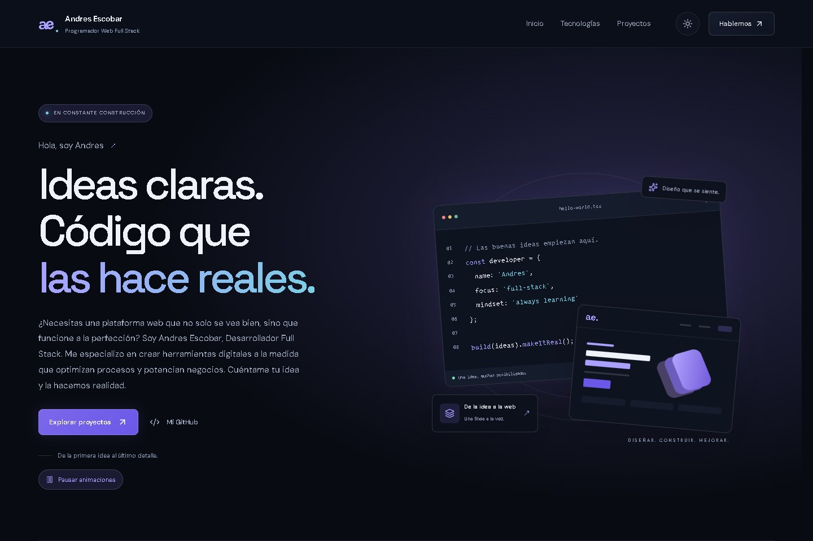

<div align="center">

# Andres Escobar · Portafolio

**Desarrollo web Full Stack · Diseño, código y atención al detalle.**

Un espacio para conocer mi trabajo, explorar mis proyectos y dar el primer paso hacia una nueva idea.

### [Ver demo en vivo ↗](https://portafolio-andres-liart.vercel.app/)

[Proyectos](https://portafolio-andres-liart.vercel.app/#proyectos) · [Contacto](https://portafolio-andres-liart.vercel.app/#contacto) · [GitHub](https://github.com/andresescobar14)

</div>



## Sobre el proyecto

Portafolio personal construido con **Next.js, React y TypeScript**. Reúne mi presentación, conocimientos técnicos, proyectos y canales de contacto en una experiencia responsive con temas oscuro y claro, animaciones de scroll y efectos interactivos con GSAP.

**Demo:** [portafolio-andres-liart.vercel.app](https://portafolio-andres-liart.vercel.app/)

## Características

- **Tema oscuro y claro:** alternancia desde el header y persistencia de la preferencia.
- **Animaciones con GSAP y ScrollTrigger:** entradas de secciones y tarjetas que se repiten al volver a recorrer la página.
- **Efectos interactivos:** glow que sigue al puntero, bordes luminosos, aro del cursor, luces ambientales y microinteracciones en botones.
- **Marquesina de tecnologías:** desplazamiento continuo con control de pausa y logos vectoriales.
- **Proyectos con acceso directo:** demo en vivo, código fuente y perfil de GitHub.
- **Contacto funcional:** validación de campos, estados de envío, confirmación y mensajes de error mediante FormSubmit.
- **Diseño adaptable y accesible:** navegación por teclado, foco visible, etiquetas de formulario y control para pausar las animaciones.

## Tecnologías

| Tecnología | Uso |
| --- | --- |
| Next.js 16 · App Router | Estructura de la aplicación y renderizado en el servidor |
| React 19 · TypeScript | Componentes, interacciones y contratos de datos |
| Tailwind CSS 4 · CSS | Composición responsive, temas y efectos visuales |
| GSAP · ScrollTrigger | Scroll, seguimiento del puntero y microinteracciones |
| Lucide · React Icons | Iconografía vectorial |
| Zod · FormSubmit | Validación y entrega del formulario de contacto |
| Vitest · Testing Library · Playwright | Pruebas unitarias, de componentes y de navegador |
| pnpm · Vercel | Gestión de paquetes y despliegue |

## Proyectos destacados

| Proyecto | Descripción | Demo | Código |
| --- | --- | --- | --- |
| Rick & Morty | Explorador de personajes con búsqueda, filtros y favoritos locales | [Abrir](https://rick-morty-andres.vercel.app/main.html) | [Repositorio](https://github.com/andresescobar14/ProyectoRickAndMorty-Andres) |
| Copia de YouTube | Recreación educativa con búsqueda, filtros y biblioteca local | [Abrir](https://andresescobar14.github.io/Copia-YouTube-Andres/) | [Repositorio](https://github.com/andresescobar14/Copia-YouTube-Andres) |
| Copia de Spotify | Reproductor educativo con búsqueda y vistas previas de audio | [Abrir](https://andresescobar14.github.io/Proyecto-Spotify-Andres/) | [Repositorio](https://github.com/andresescobar14/Proyecto-Spotify-Andres) |
| Barbería · Turnos | Agenda de reservas construida con Next.js y Supabase | [Abrir](https://barberia-ae.vercel.app/) | [Repositorio](https://github.com/andresescobar14/barberia-turnos) |
| Nexo · Registro | Demostración de registro por pasos con validaciones accesibles | [Abrir](https://proyecto-registro-andres.vercel.app/) | [Repositorio](https://github.com/andresescobar14/proyecto-registro-andres) |

## Ejecutar en local

### Requisitos

- Node.js **24.x**.
- pnpm **12.5.1**, fijado en `web/package.json`.
- Git.

La aplicación se encuentra en **`web/`**. Todos los comandos de desarrollo se ejecutan desde esa carpeta.

```sh
git clone https://github.com/andresescobar14/PORTAFOLIO-AndresE.git
cd PORTAFOLIO-AndresE/web
pnpm install --frozen-lockfile
pnpm dev
```

Abre [localhost:3000](http://localhost:3000/).

El proyecto utiliza exclusivamente pnpm. La instalación comprueba el gestor y el lockfile para mantener un entorno consistente.

### Comandos disponibles

| Comando | Descripción |
| --- | --- |
| `pnpm dev` | Inicia el servidor de desarrollo |
| `pnpm build` | Genera la compilación de producción |
| `pnpm start` | Sirve la compilación de producción |
| `pnpm lint` | Revisa el código con ESLint |
| `pnpm typecheck` | Comprueba los tipos con TypeScript |
| `pnpm test` | Ejecuta las pruebas con Vitest |
| `pnpm test:watch` | Ejecuta Vitest en modo observación |
| `pnpm test:e2e` | Ejecuta las pruebas de navegador con Playwright |
| `pnpm check:manager` | Verifica el gestor y los lockfiles |
| `pnpm icons:generate` | Regenera el sprite de logos de tecnologías |

Para preparar Chromium antes de ejecutar las pruebas de navegador:

```sh
pnpm exec playwright install chromium
pnpm test:e2e
```

Para abrir el sitio desde otro dispositivo de la misma red, inicia `pnpm dev --hostname 0.0.0.0` y configura la IP del equipo en `allowedDevOrigins`, dentro de `web/next.config.ts`.

## Estructura

```text
PORTAFOLIO-AndresE/
├── .github/workflows/       # Verificación continua
├── docs/                   # Vista previa del portafolio
└── web/
    ├── public/
    │   ├── icons/          # Sprite SVG compartido
    │   └── projects/       # Imágenes de los proyectos
    ├── scripts/            # Control de pnpm y generación de logos
    ├── e2e/                # Pruebas de navegador
    └── src/
        ├── app/            # Página, layout, metadatos y estilos globales
        ├── components/     # Secciones y componentes de interfaz
        ├── data/           # Perfil, tecnologías y proyectos
        ├── domain/         # Reglas de validación del contacto
        ├── hooks/          # Comportamiento del formulario y animaciones
        ├── lib/            # Inicialización del tema y del movimiento
        ├── services/       # Integración HTTP con FormSubmit
        └── types/          # Contratos compartidos
```

## Personalización

| Archivo | Qué puedes modificar |
| --- | --- |
| `web/src/data/portfolio.ts` | Nombre, presentación, correo, tecnologías y proyectos |
| `web/src/app/globals.css` | Colores, temas, composición responsive y efectos |
| `web/src/hooks/usePortfolioMotion.ts` | Animaciones de scroll, luces y seguimiento del puntero |
| `web/src/app/layout.tsx` | Título, descripción, metadatos y fuentes |
| `web/public/projects/` | Capturas que aparecen en las tarjetas |

### Formulario de contacto

El formulario está conectado a **FormSubmit** y utiliza el correo definido en `profile.email`. No requiere API keys para esta integración.

Si adaptas el proyecto y cambias el destinatario, realiza un primer envío y activa la nueva dirección desde el correo de confirmación de FormSubmit. La confirmación visual aparece cuando el proveedor acepta la solicitud; si hay un error, el formulario conserva el mensaje para reintentarlo.

[Documentación de FormSubmit](https://formsubmit.co/ajax-documentation)

## Rendimiento y calidad

- Componentes de contenido renderizados en el servidor e hidratación de las interacciones necesarias.
- Fuentes servidas localmente e imágenes con `next/image`, dimensiones reservadas y formatos AVIF/WebP.
- Un sprite SVG compartido para evitar repetir las rutas de los logos en el HTML, con nombre basado en su contenido y caché inmutable.
- Importación asíncrona de GSAP, seguimiento del puntero con `requestAnimationFrame` y `quickTo`, y luces ambientales pausadas fuera de la pantalla.
- Pruebas de navegación, temas, formularios, scroll, efectos y adaptación a móvil, tablet y escritorio. Las pruebas automatizadas del contacto simulan al proveedor y no envían correos reales.

GitHub Actions ejecuta la instalación congelada, el control de pnpm, ESLint, pruebas, compilación, TypeScript y Playwright.

## Despliegue en Vercel

Importa el repositorio y utiliza estos ajustes:

| Ajuste | Valor |
| --- | --- |
| Framework | Next.js |
| Root Directory | `web` |
| Node.js | `24.x` |
| Install Command | `pnpm install --frozen-lockfile` |
| Build Command | `pnpm build` |
| Output Directory | Predeterminado de Next.js |

**Demo pública:** [https://portafolio-andres-liart.vercel.app/](https://portafolio-andres-liart.vercel.app/)

## Autor

**Andres Escobar** · Desarrollador Web Full Stack

[GitHub](https://github.com/andresescobar14) · [Correo](mailto:gamerandres0102@gmail.com) · [Contactar desde el portafolio](https://portafolio-andres-liart.vercel.app/#contacto)
